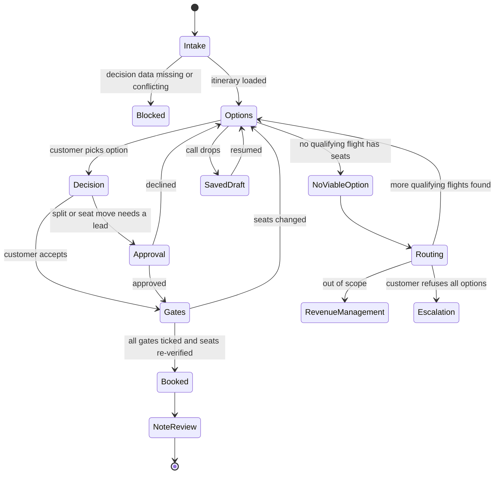

# Storm Rebooking Assistant: Specification

Version 0.3 (draft), 26 Nov 2026. Supersedes v0.2. v0.3 settles who can fly alone in a split (11.1) and what must happen with the customer before any split is confirmed (11.2).

> **Implementation status.** `service/` implements the bulletin rules (sections 5, 7.1, 9, 12) and the routing in 9.3. It departs from this spec on seating: sections 7.2 and 11 (age bands, who can fly alone, the consent protocol before a split, no scattered seats) are reduced to warnings, because the service follows a simpler rule set (see `service/README.md`, "Where this departs from the spec"). Until one is updated to match the other, the service is the behaviour that runs and this document is the intended safeguard.

Rules come from the *Storm Travel Waiver Fare Rules Bulletin (Denver, November 2026)*, issued 15 Nov 2026 and encoded in `rules/storm-waiver-den-nov26.yaml`. Behaviour the bulletin does not cover is labelled **floor practice** (from the Rosalind Mkhize interview, INT-ROSALIND-01) or **spec rule** (our design choice). Unconfirmed items are tagged `[ASSUMPTION]` and tracked in `docs/open-questions.md`. Evidence is in `docs/evidence.md`.

## 1. Purpose and goal

Help agents rebook passengers whose flights the Denver storm cancelled, faster and with fewer errors. The assistant applies the bulletin's rules, finds and ranks qualifying flights, states the fare outcome, drafts the booking note, and routes what agents cannot process. It never books, and the agent and customer decide anything that changes the trip.

Goal: halve average handle time. Baseline 14.4 min (solo 11.4, pair 14.4, party of 3+ 21.6). Target 7.2 min.

## 2. Scope

**In scope:** rebooking cancelled itineraries on agent-handled calls; flight filtering and ranking; party seating; the fare outcome; the documentation line and booking note; routing to Revenue Management, leads, and supervisors; step timing.

**Out of scope:** moving other passengers' seats (a lead does that with the gate); alternate-airport and out-of-window requests (Revenue Management); refund terms ("standard fare rules" are not defined in the bulletin); hotel-voucher eligibility (the assistant records what the agent promised); pricing logic owned by the booking platform.

## 3. Principles

1. **Suggest, never book.** The agent presses book, after the gates in section 8.
2. **The bulletin is the rulebook.** Every filter and fare statement cites its clause. The assistant adds no eligibility rules of its own.
3. **The flag is the decision.** The assistant and the agent never re-assess `waiver_eligible` (clause 1.4).
4. **Never guess.** Missing or conflicting decision data blocks the quote; it does not produce a best guess.
5. **Customer consent for anything beyond the cancellation:** a split party, a later departure, a fare difference.
6. **One state through every step.** Party, chosen flights, and fare outcome carry across the workflow. No re-keying.
7. **Fail visibly.** Stale or inconsistent data stops the booking.

## 4. Roles

| Role | Does |
|---|---|
| Agent | Runs the call, confirms with the customer, books |
| Customer | Chooses among options, consents to splits and fare differences |
| Lead | Approves splits and seat moves, handles disputes (floor practice) |
| Supervisor | Handles refund requests and escalated disputes (floor practice) |
| Revenue Management | Manually reviews out-of-scope requests (clauses 2.5, 4.3) |
| Assistant | Filters, suggests, checks, drafts, routes, records timing |

## 5. Data contract

**Named in the bulletin (exact field names):**

| File | Fields |
|---|---|
| `cancelled_bookings_denver_storm.csv` | `waiver_eligible`, `fare_class`, `fare_paid_usd`, `earliest_acceptable_departure` |
| `flight_seat_availability.csv` | `flight_status` (`scheduled`, `delayed`, `cancelled`), `departure_datetime`, `fare_class_open` |

**Needed but not named `[ASSUMPTION]`:** original confirmation number (required by clause 3.6); passengers per booking, each with an adult or minor flag (OQ-04); origin, destination, original flight; loyalty tier (exists per 4.2, never affects fare); per-flight open seats with adjacency; any onward connection and its required arrival time (OQ-07); a price for the open fare (`fare_class_open` reads like a class, not an amount, OQ-01). We have not seen the two CSV files; confirm these fields against them.

**Dates.** All rule evaluation takes an `as_of` date (the request date). The waiver accepts requests through 23 Nov 2026 (1.5, 2.5). After that date every request routes to Revenue Management, so rules are versioned config with effective dates, not code (OQ-15). Prototype replays use the call date.

## 6. Call flow

## 7. What the assistant does

### 7.1 Automatic, no agent judgment needed

| Action | Rule | Clause |
|---|---|---|
| Drop cancelled flights; keep `scheduled` and `delayed` | Hard filter | 2.3 |
| Drop flights departing before `earliest_acceptable_departure`, even with open seats | Hard filter | 2.4 |
| Keep only the original origin and destination airport pair | Hard filter | 2.2 |
| For covered bookings, keep only departures 18 to 23 Nov inclusive | Hard filter | 2.1 |
| For non-covered bookings, apply 2.2 to 2.4 only (window not applied, literal reading of 4.3) | Hard filter, OQ-02 | 4.3 |
| Route requests after 23 Nov, outside the window, or for another airport to Revenue Management | Never offered as options | 2.5, 4.3 |
| State the fare outcome from the flag (section 9) | Deterministic | 3.1 to 3.4, 4.1 |
| Draft the documentation line (section 12) | Present only on covered bookings | 3.6, 4.4 |
| Re-verify seats at the moment of booking | Gate G7 | n/a |

Also automatic and not from the bulletin: seat and flight search across the whole qualifying set in one query, so agents stop paging one flight at a time (INT-ROSALIND-01 [00:01:09]), and an onward-connection filter where connection data exists (OQ-07).

### 7.2 Options: suggested, agent and customer decide

Each option is a complete plan for the whole party (schema: `schemas/rebooking-option.schema.json`).

**Additional hard filters, spec rule:** seats exist for everyone on each leg; every onward connection is reachable (OQ-07); the minors rule in section 11 holds.

**Ranking, applied in order:** (1) party arrives together, (2) earliest arrival at the final destination, (3) no delay flag, (4) no fare difference. Delayed flights are usable under 2.3, so a delay lowers rank and shows a flag; it never removes an option. Agents have chosen to avoid a weather-risk delay for children (INT-ROSALIND-01 [00:12:52]), and the customer can decide that too.

**Presentation:**
- At most three options, ranked, each with the reason it sits where it does.
- For parties of 3+ with no flight that seats everyone together, always show a fixed pair side by side: the **earliest all-together** option and the **earliest split** option, with arrival times and the gap. The assistant does not label either as the default. Customers differ: a mother refused next-morning (INT-ROSALIND-01 [00:12:52]) and the party of five in CL-052 refused any split.
- Elapsed call time is visible. At 10 minutes with no accepted option, show the routing choices in section 10 and prompt the agent to update the customer `[ASSUMPTION: threshold]`. Abandoned calls ended at 12.9 and 10.3 minutes (CL-029, CL-055).

### 7.3 Fare outcome

Computed per section 9 and shown with the clause numbers behind it. The agent never has to reopen the bulletin.

### 7.4 Routing and escalation packets

One packet format serves every route: party and ages, itinerary, options tried and why each failed, the customer's stated position, fare outcome, and the exact question. See section 9.3 for routes.

### 7.5 Timing

The assistant records step start and end from events (screen entered, option selected, booking confirmed, note saved). Agents never start timers, which closes the gaps in CL-022 and CL-041.

## 8. What the agent must confirm before booking

The book action stays disabled until every applicable gate is ticked.

| Gate | Agent confirms | Assistant shows | Applies |
|---|---|---|---|
| G1 Party | Passenger count and each passenger's age band (adult 18+, teen 12 to 17, child 5 to 11, under 5, lap infant) match what the customer says; anyone who depends on another party member is flagged | Itinerary summary | Always |
| G2 Option | Customer accepted these flights, times, seats, arrival | The chosen option | Always |
| G3 Fare | Covered: the customer was told there is no charge, the fare carries over, and no change fee applies. Not covered: the customer heard the amount and accepted it | Fare outcome with clauses | Always |
| G4 Split | Every step of the split protocol in 11.2 is done: customer agreed to this exact split, who flies alone fits the table in 11.1, any condition the customer set is resolved and the final plan restated | Split panel with the protocol steps | Split options |
| G5 Approval | A lead's approval is on record | Approval status | Splits and seat moves (config, OQ-06) |
| G6 Promises | Anything promised, such as a voucher, is listed | Promise field | Always, may be empty |
| G7 Freshness | Nothing; automatic. Seats are re-verified now | Warning if inventory changed | Always |
| G8 Documentation | The drafted line is right: present with the original confirmation number on every rebooked flight for covered bookings, absent for non-covered ones | Draft note | Always |

Agents are no longer asked to re-read the waiver, check fare class, or check loyalty tier. Clause 1.4 makes the flag the decision, 3.3 makes fare class irrelevant to the covered quote, and 4.2 makes tier irrelevant to both.

If G7 finds changed inventory, the assistant discards the option and re-ranks rather than booking on stale data. Seats vanished mid-call in CL-024, 028, 032, and 034.

## 9. Fare rules

### 9.1 Decision table

| Condition | Outcome | Agent sees |
|---|---|---|
| `waiver_eligible` true and the flight passes the covered filters | `COVERED_NO_DIFFERENCE`. No amount collected or refunded; `fare_paid_usd` unchanged; no change fee or same-day charge. Open fare class need not match | "No charge. Fare stays $X." Clauses 3.1 to 3.4 |
| `waiver_eligible` false and the flight passes the non-covered filters | `NOT_COVERED_DIFFERENCE`. Change permitted for all four fare classes. Difference collected if the open fare on the new flight is higher than the fare paid | Amount, or "no difference". Clause 4.1 |
| Request is after 23 Nov, outside the window (covered), or for another airport | `ROUTE_TO_REVENUE_MANAGEMENT`. Not processed by the agent | Reason, clause 2.5 or 4.3 |
| `waiver_eligible` missing, or its value differs between sources | `BLOCKED`. No quote | Both values |

Fare class only matters for non-covered bookings, where it sets refund treatment ("per standard fare rules" for all four classes, which the bulletin does not define). A fare class that displays differently on two screens (CL-051) does not block a covered quote.

### 9.2 What the assistant never says

- It does not quote refund terms; the bulletin refers to "standard fare rules" without defining them.
- It does not state that an exception exists. The bulletin has no exception mechanism and says agents do not re-assess eligibility (1.4). A customer who disputes a difference goes to a lead as floor practice (OQ-08).
- It does not offer an alternate airport.
- It does not apply a fare penalty, change fee, or fare difference to any member of a covered split party (3.5).

### 9.3 Routes

| Situation | Route | Basis |
|---|---|---|
| Out-of-window, after 23 Nov, or alternate-airport request | Revenue Management manual review. The agent tells the customer it is under review (OQ-10) | 2.5, 4.3 |
| Customer disputes a fare difference | Lead, then supervisor | Floor practice (INT-ROSALIND-01 [00:07:05]) |
| Seat move affecting other passengers | Lead, who checks with the gate | Floor practice (INT-ROSALIND-01 [00:13:43]) |
| Split approval | Lead, configurable | Floor practice (OQ-06) |
| Refund request | Supervisor (CL-042) | Floor practice (OQ-09) |

### 9.4 Not-covered splits

Section 3.5 protects only covered parties. For a non-covered party the change and fare-difference rules apply to each member on each flight, so the assistant prices each member's flight separately. Clause 4.3 still requires every flight to meet 2.2 to 2.4.

## 10. When no flight works

"No flight works" means no flight passes the filters in 7.1 with seats for the party.

1. **Search the whole qualifying set:** every day through 23 Nov for covered bookings (no upper limit for non-covered, OQ-02), any seating arrangement, split parties (section 11), and connecting routings between the same airport pair `[ASSUMPTION]`, OQ-17.
2. **Route what cannot be processed:** if the customer wants a different airport, a later date than the window, or the request falls after 23 Nov, send it to Revenue Management and tell the customer. Alternate airports are not an agent option.
3. **Escalate:** if the customer refuses every option or asks for a refund, send the packet to a lead or supervisor.

The assistant records the outcome. Hotel vouchers are recorded only if the agent says one was promised (G6).

## 11. Seating a party when seats are short

Full reasoning: `docs/decisions/0001-split-party-seating.md`.

**Bulletin facts:** a split party may use more than one flight with no fare penalty, change fee, or fare difference when covered (3.5). Every flight must meet Section 2, so the later flight must also be at or after `earliest_acceptable_departure` and inside the window. The bulletin says nothing about who may travel apart; everything in 11.1 and 11.2 is a spec rule, to be confirmed by the policy owner (OQ-04).

### 11.1 Who can fly alone

Airline facts are from Southwest's help center: children 5 to 11 traveling without an accompanying passenger age 12 or older must travel as Unaccompanied Minors, and travelers 12 to 17 alone are Young Travelers, not Unaccompanied Minors. Unaccompanied Minor travel has its own form, pickup details, and service charge, so the assistant never builds a split that would need it. Other websites quote different ages; Southwest's own pages govern.

| Passenger (age band from G1) | May be on a flight group with no adult (18+) from the party? | Rule |
|---|---|---|
| Adult, 18+ | Yes | May fly alone |
| Teen, 12 to 17 | Only with the guardian's explicit, recorded consent | The airline allows teens alone, but the assistant ranks options that keep a teen with an adult higher and never proposes the teen-alone split first |
| Child, 5 to 11 | No | Needs an adult (18+) from the party on the same flight. This is stricter than the airline minimum (any companion 12 or older) on purpose |
| Child under 5 | No | Same as 5 to 11. Southwest's official minimum age for solo travel was not confirmed in the pages found, so never alone |
| Lap infant (under 2) | No. Never separated from the adult holding them | Takes no seat; moves with that adult |
| Anyone the customer says needs a companion | No | Treated like a child under 5 `[ASSUMPTION]` |

Two consequences: a teen is never the only companion of a child under 12, and the assistant never picks which adult flies alone. The group with the children takes the earliest flight, and the customer chooses who the lone adult is.

| Party | Splits the assistant may offer on three seats | Never offered |
|---|---|---|
| 2 adults and 2 children under 12 | One adult and both children on the earlier flight; the other adult on the next flight | Any child without an adult |
| 2 adults, 1 child under 12, 1 teen | One adult, the child, and the teen together; the other adult later. The teen apart only with guardian consent | The child without an adult |
| 1 adult and 3 children under 12 | None. Only all-together options | Any split |
| 1 adult, 2 children under 12, 1 teen | The adult and both children together; the teen alone only with guardian consent, otherwise no split | The teen with the children but no adult |
| 4 adults | Any split | None |

### 11.2 Before the agent confirms any split

The book action for a split stays disabled until the assistant's split panel shows every step done. The panel supplies the wording; the agent has the conversation.

1. **Show the comparison.** The split option and the earliest all-together option side by side, with the arrival gap (7.2).
2. **State the split plainly.** For each group: who flies, which flight, departure and arrival times, seats; who flies later and when they arrive. Say nothing about lodging or vouchers unless the agent actually promises one (G6).
3. **State the fare treatment.** Covered: no fare penalty, change fee, or fare difference for any member because of the split (3.5). Not covered: each member's amount (9.4).
4. **Get an explicit yes to this exact split** from an adult in the party. If the person flying separately is not on the call, the caller confirms that person agrees, and the agent records who said so. For a teen travelling without an adult, the guardian says yes to that specifically.
5. **Treat any condition as provisional.** If the customer says yes only if something is tried, such as asking about seat moves (INT-ROSALIND-01 [00:12:52]), the agent resolves it first, restates the final plan, and gets a second yes.
6. **Get lead approval if configured** (OQ-06), recorded with the lead's name. A lead's approval never replaces the customer's yes, and a lead cannot consent on the customer's behalf.
7. **Re-verify seats** at the moment of booking (G7). If anything changed, restate and re-confirm.
8. **After booking, close the loop.** The assistant fills each booking's note with the other booking's number by lookup and the agent reviews it; covered splits carry the documentation line on every flight (3.6); the agent reads both booking numbers and flight times back to the customer.

If the customer declines, the assistant returns to the all-together options with no default and no pressure. If the customer refuses every option, follow section 10 step 3.

### 11.3 Family of four, three adjacent seats on the best flight

Generate options in this order and present them per 7.2:

| # | Option | Eligible when |
|---|---|---|
| 1 | Same flight, three adjacent plus one apart | A fourth seat exists on the flight, the adjacent group meets 11.1 (every person who may not be without an adult has one), and same-flight non-adjacent seating is allowed. Behind a flag, off by default (OQ-05) |
| 2 | Same flight after a lead-approved seat move | Option 1 is declined or not allowed; the lead asks the gate |
| 3 | Earliest all-together flight | Any qualifying flight with four seats together |
| 4 | Split across flights | A group that meets 11.1 on the earliest flight; the remaining adult on the next soonest qualifying flight |

Options 3 and 4 appear as the side-by-side pair. The assistant does not choose between them. Option 4 is offered only when 11.1 allows a split for that party, and it needs the full protocol in 11.2.

## 12. Booking notes and the documentation line

**Required by the bulletin (3.6, 4.4):**
- Covered booking: record `STORM WAIVER DEN NOV26` followed by the original confirmation number. For a split party, record the same line and original confirmation number on each rebooked flight.
- Non-covered booking: never record the line.

The assistant builds this line from the data, so no typing is needed, and validates the format before submit. A notes tool that rejects the format (CL-008) is caught early (OQ-12).

**Floor practice, recommended:** the note also carries old flight, new flight, time rebooked, waiver used or not, and anything promised. For a split, each booking's note states that the party was split, why, who approved it, and the other booking's number. The assistant fills the other number by lookup after both bookings exist and checks that the cross-link is reciprocal, replacing the hand-typed numbers Rosalind reads back twice (INT-ROSALIND-01 [00:14:34]).

## 13. Failure handling

| Failure | Behaviour | Seen in |
|---|---|---|
| Seats change between pick and confirm | G7 re-verifies, re-ranks, tells the agent | CL-024, 028, 032, 034 |
| Session drops or screen times out | Restore full workflow state on re-login; the search is not repeated by hand | CL-002, 038, 043 |
| Notes save fails or freezes | Keep the draft in the assistant; retry without retyping | CL-008, 020, 037 |
| Caller hangs up or the line drops | Save the draft with options and gates; any agent can resume | CL-029, 055 |
| `waiver_eligible` conflicts or is missing | `BLOCKED` with both values | n/a |
| Lead slow to respond | Packet and its status stay visible; the agent is not stuck on the screen | INT-ROSALIND-01 [00:08:25] |

## 14. Metrics and budget

Baseline from 55 clean calls. The per-step budget is a proposal to validate in the prototype, not a forecast. It sums to 6.7 minutes, leaving 0.5 min of slack against the 7.2 goal.

| Measure | Baseline | Target |
|---|---|---|
| Find Open Flights | 5.41 | 2.5 |
| Check Waiver Rules | 3.03 | 0.5 |
| Reseat Party | 2.18 | 1.2 |
| Confirm And Notify | 1.97 | 1.7 |
| Document Booking | 1.80 | 0.8 |
| **Total Handle Time** | **14.40** | **7.2** (budget 6.7) |
| Hold Time | 3.52 | 1.8 |
| Screens Switched | 11.13 | 3 or fewer `[ASSUMPTION]` |
| Party of 3+ handle time | 21.6 | 10.8 |

Check Waiver Rules shrinks most because the bulletin removes the judgment: it averages 2.60 min on covered calls and 4.58 on non-covered, and agents currently reopen the waiver every time for Anytime and Business Select (INT-ROSALIND-01 [00:06:42]). Confirm And Notify is mostly the customer conversation, so it moves least.

Guardrails (must not worsen): wrong fare outcomes, documentation-line errors, split-party cross-link errors (target zero), escalation rate (3 of 55 clean calls today), abandoned calls (2 of 60 today), and customer acceptance of the first option set.

## 15. Acceptance tests

Fixtures are real calls; each replays the scenario with inputs reconstructed from the log, using the call date as `as_of`.

| ID | Scenario | Pass when |
|---|---|---|
| AT-01 | Simple solo, covered (CL-025) | Qualifying options in one workspace; `COVERED_NO_DIFFERENCE` with clauses 3.1 to 3.4; documentation line drafted with no typing |
| AT-02 | Non-covered booking (CL-003) | Section 4 treatment shown; difference computed from the price source; no documentation line (4.4) |
| AT-03 | Fare class differs between screens (CL-051) | A covered quote is not blocked; a conflicting `waiver_eligible` value is `BLOCKED` |
| AT-04 | Family of four, three adjacent seats (CL-004, CL-039) | Options follow section 11; split blocked until G4 and G5; every rebooked flight carries the documentation line and original confirmation number; both flights meet Section 2 |
| AT-05 | Party of five refuses to split (CL-052) | All-together option offered; if refused, a packet goes to the supervisor with options tried |
| AT-06 | Seats vanish before confirm (CL-024, CL-034) | G7 blocks booking and re-ranks; no stale booking |
| AT-07 | Session drops mid-search (CL-038) | State restored; no step time lost or invented |
| AT-08 | Notes tool rejects or freezes (CL-008, CL-020) | Draft kept; line format error shown before submit |
| AT-09 | Caller hangs up mid-search (CL-029) | Draft saved and resumable |
| AT-10 | Refund request (CL-042) | Supervisor packet; no refund terms stated |
| AT-11 | Child under 12 in the party | No option leaves the child without an 18+ party member; a teen is never the only companion; the 11.1 table is reproduced for each party composition in it |
| AT-12 | Customer wants a different airport (CL-012) | Routed to Revenue Management citing 2.2 and 2.5; not offered as an option |
| AT-13 | Delayed flight with seats | Offered with a delay flag and lower rank; not removed (2.3) |
| AT-14 | Open seats on a flight before `earliest_acceptable_departure` | Flight never shown (2.4) |
| AT-15 | Different loyalty tiers, same booking otherwise | Identical fare outcome (4.2) |
| AT-16 | Request dated after 23 Nov | `ROUTE_TO_REVENUE_MANAGEMENT`, no options (2.5) |
| AT-17 | 1 adult and 3 children under 12, three seats on the best flight | No split offered; only all-together options |
| AT-18 | Split offered | Book disabled until protocol steps 1 to 6 are ticked; a conditional yes is not accepted as final |
| AT-19 | Teen would travel without an adult | Option shown only after recorded guardian consent, and ranked below options keeping the teen with an adult |
| AT-20 | Party includes a lap infant | Infant moves with the holding adult and uses no seat |
| AT-21 | Seats change after the customer agreed to a split | G7 blocks booking; the new plan is restated and re-confirmed |

## 16. Dependencies

Needed from the booking platform: a multi-flight availability query with adjacency, an open-fare price source, a single source for `waiver_eligible`, an in-tool channel for lead approvals, a documented Revenue Management handoff, and (if allowed) a short seat hold. Without the seat hold the service relies on G7. See `docs/open-questions.md`.
